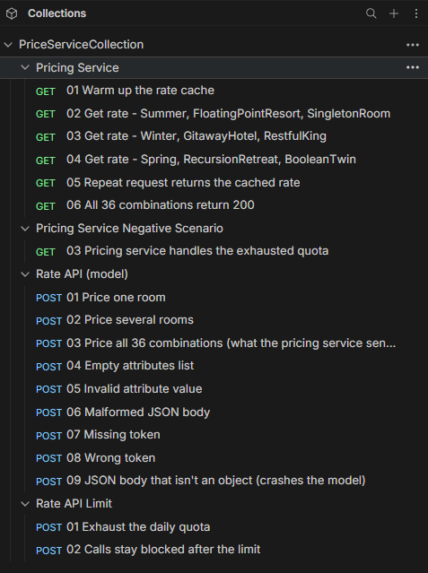

<div align="center">
   
</div>

# Dynamic Pricing Proxy

A service that provides a dynamic price of hotel rooms given a set of hotel x room x period by calling RateAPI model.

## How to build, run and test the service

```bash

# --- 1. Build & Run The Main Application ---
# Build and run the Docker compose
docker compose up -d --build

# --- 2. Test The Endpoint ---
# Send a sample request to your running service
curl 'http://localhost:3000/api/v1/pricing?period=Summer&hotel=FloatingPointResort&room=SingletonRoom'

# --- 3. Run Tests ---
# Run the full test suite
docker compose exec interview-dev ./bin/rails test

# Run a specific test file
docker compose exec interview-dev ./bin/rails test test/controllers/pricing_controller_test.rb

# Run a specific test by name
docker compose exec interview-dev ./bin/rails test test/controllers/pricing_controller_test.rb -n test_should_get_pricing_with_all_parameters
```

If you have a Bruno installed in your machine, you can also import the Bruno collection file I provided in [github.com/mjperpinosa/bruno-collection-dynamic-pricing](https://github.com/mjperpinosa/bruno-collection-dynamic-pricing/) and do your tests there.

```Shell
git clone https://github.com/mjperpinosa/bruno-collection-dynamic-pricing.git

In your Bruno, click + button > Import collection
Navigate to your cloned collection and choose the collection yml file.
```

Then you will be able to run the test below.



## High Level Design Decisions to meet the requirements

For the sake of this assignment only, please refer to the **Decisions** section in mj-notes.txt. To avoid further redundancy, I will avoid copy and pasting them to this readme file. But in practice, I would officially document them in README file or some other appropriate place like Confluence Page or other platform that the team is using for documentation.

## AI Assistance

The main logic implementation was developed with the Claude Code following the design decisions I provided. Please see the prompt I provided to the coding agent below which is also present in mj-notes.txt.

> Prompt:
> Note: run everything through docker compose
>
> Requirements: GET /api/v1/pricing should return rates that are not older than 5 min, and handles 10k+ requests/day. The pricing model, POST /pricing on tripladev/rate-api, allows only up to 1,000 calls/day per token. Let's count every call, failed or not!
>
> You should implement the requirements with below decisions (don't come up with your own).
> I already created two files in lib folder, tthe rate_cache.rb and token_bucket.rb where you need to put the appropriate logic for caching and token bucket. Modify the existing files as required especially the pricing_service.rb and rate_api_client.rb. The service should also have a retry_after that is accessible as I already assumed it in the pricing_controller.
>
> Decisions:
> Caching
>
> - Fetch all 36 period x hotel x room combinations in one batch call only (the model's
>   POST /pricing takes an attributes array) and cached them in memory
> - RateCache (app/services, one instance per process) holds one immutable snapshot:
>   all 36 rates plus fetched_at. Don't use Rails.cache!
> - fetched_at = monotonic time when the call to the RateAPI model request started. Never serve a snapshot that's >= 5 mins old.
> - From around 4.5 mins, the next request should refreshes the snapshot. In case the request fails, serve the old snapshot as long as it's <= 5 mins old.
> - During refresh or call to the model, only one request should be allowed at a time since it already refreshes the entire snapshot of rates. Before any call to the model, should always check if the snapshot is fresh, because when it was already refreshed, the queued requests to the model are no longer necessary, they can already take the data from the cache (always check if data is fresh meaning <= 5 mins old.)
>
> Failures
>
> - The model isn't reliable, it can be slow or hanging, could return 5xx, or return 200 with an error body or without rates, and the rate can be a number or a string. Thee API should be able to handle all of these situations.
> - If a call fails, retry once right away. Don't retry on 429 (too many requests) because this means that the quota is already used up!
> - If it still fails, don't call the model again for 5 seconds (60 secs after a 429).
>   Just return 503 during that time, a simple circuit breaker without the half-open
>   state.
>
> Daily budget implement in token_bucket.rb file
>
> - Implement a simple token bucket as our safety net so we never use up the model's daily quota, even if their is model's RateAPI outage or there's a bug in the retries.
> - Make sure to make it thread-safe
> - Normal traffic only needs around 400-500 calls a day, so it should only kick in
>   when the model is down for a long time.
> - When token bucket is empty, don't call the model. Return 503 with Retry-After = when the next token comes in, and use that as the cooldown too.
> - Make sure to put logging like "budget exhausted", etc.
>
> rate_api_client.rb
>
> - Keep the existing class. Change get_rate to get_rates(attributes), which sends all
>   the combinations in one POST /pricing RateAPI.
> - Make sure to implement timeouts in case the RateAPI has very delayed response
> - In case of erros, put the HTTP status and the first part of the body in the error message for the logs. Don't show it to our client users.
> - The whole response is a failure if:
>   - the status isn't 2xx
>   - the body isn't JSON (an HTML error page for example)
>   - there's no "rates" array (or like a 200 with {"status": "error", ...})
>   - any combination we asked for is missing or has an invalid rate
>     We only want complete data in the cache. Ignore extra entries we didn't ask for.
> - Return a map of combination -> rate as an integer. Make sure to hadle it in case the model return an inconsistent type for the rate, e.g. 1000 or "1000". Let's reject negative values, decimals, empty or non-numeric strings, and null.
>
> API
>
> - If we can't get a valid rate because of the model, the service should set retry_after
>   and adds a message to errors, something like "Pricing is temporarily unavailable:
>   the pricing model did not respond in time. Please retry in xxx seconds." The controller should returns 503 with Retry-After.
> - The message should say what happened in plain words: didn't respond in time,
>   returned an error, daily quota used up, or limiting/throttled. Make sure to not pass the model's response to client users.
> - Make sure to have one JSON log line per call to the model: outcome, attempt, duration, error, tokens left, etc.
>
> Others
>
> - Don't remove even if there are unused parts of the project setup (database config etc.). I will review them myself and take action
>
> Tests
>
> - Use the existing test setup. But make sure to use a mocking so that the tests won't make a real call/requests sp that tests won't use the quota!
> - For client, test the success, string to integer, all the failure cases, timeout,
>   connection refused.
> - For cache, use a fake clock and a fake client that each test can control/manipulate per call.
>   Test the following scenarious:
>   - freshness, with the age counted from the request start
>   - the early refresh, and serving the old snapshot when it fails
>   - retry, cooldown, and 429
>   - the budget and the logs
> - With real threads, you should test that only one call goes to the model when lots of requests come at the same time, and that requests don't wait during the early refresh. Use
>   timeouts so a broken implementation fails the test instead of hanging.
> - Simulate a whole day for example 10k+ requests and some of the model calls failing. Should be <= 1000 calls, no rate 5 mins old or more is served, etc. Also simulate the model being down the whole day, it should never go over the budget.
> - Test the controller end to end through the real client.
> - Then break each rule on purpose, one by one, and check that a test fails.
>
> After that, test with the real rate-api container:
>
> - A few minutes of load, count the model calls in the logs and check that it
>   refreshes around 4.5 mins.
> - Stop rate-api, then a 503 Retry-After should be returned. Start it again and it should
>   recover.

## Thought Process

I was not able to put everything in writing because I sometimes think about the problem while doing something else like during washing dishes, doing offline activities etc. But please refer to mj-notes.txt especially the prompt I wrote for the coding agent since I put there almost everything.
Moreover, about my decision of using AI agent in this assignment, I honestly think that letting claude write the implementation was a better choice than coding it myself. If I did it on my own, I think I would spend most of my time looking up Ruby syntax and Rails conventions etc.. Instead, I spentd my time on what actually matters in this assignment, that is designing a production-grade service that works within the given constraints. Which includes decising how long data can stay in the cache, how to stay under the model's 1,000 calls a day, what the service does when the model fails or the quota runs out, what happens when the model is slow or hanging etc.. Then I went through the code until I understood how each part works and why it's there, from the cache and the cooldowns to the timeouts and the token bucket etc.. To me, this proves that if you understand the problem and know what needs to be done, the programming language shouldn'will never be a blocker for building something!
